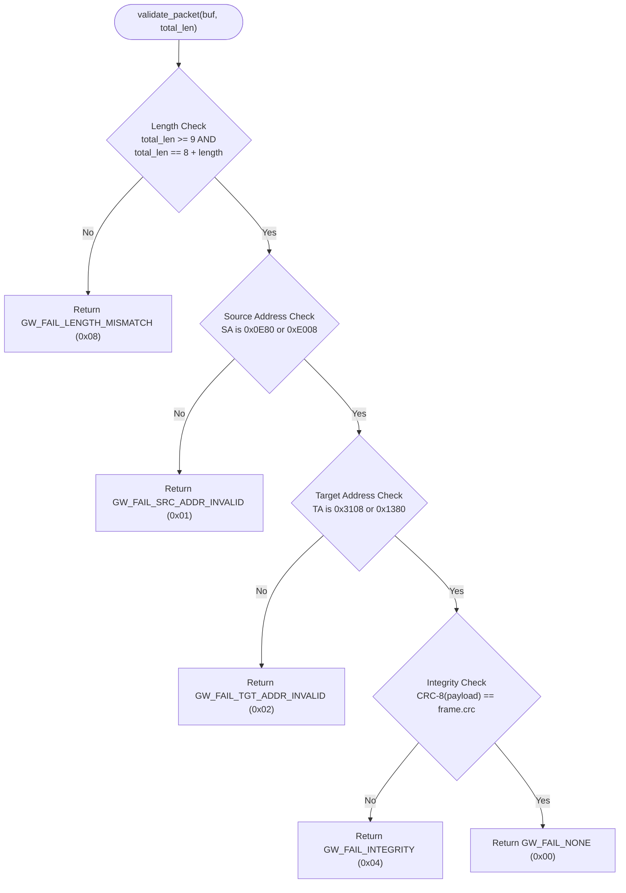
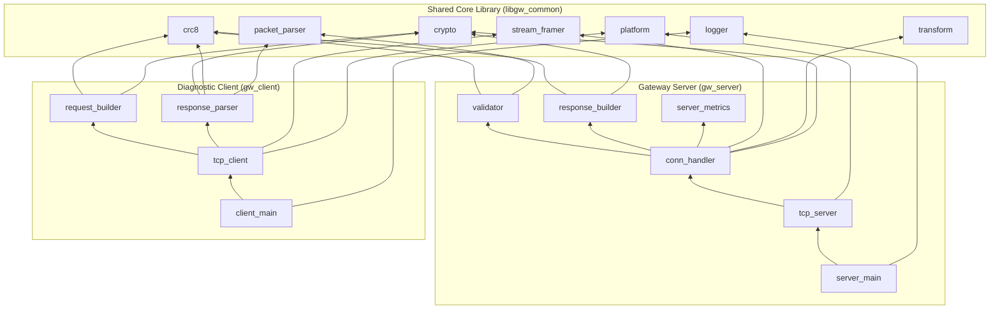
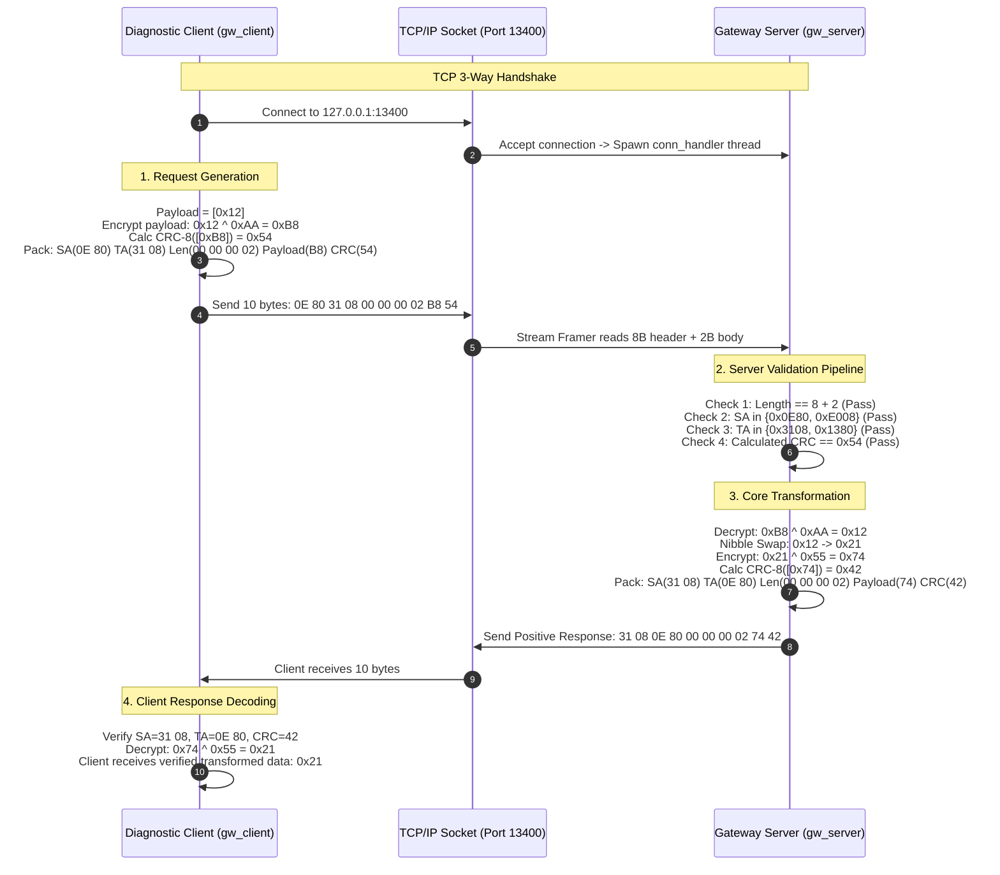
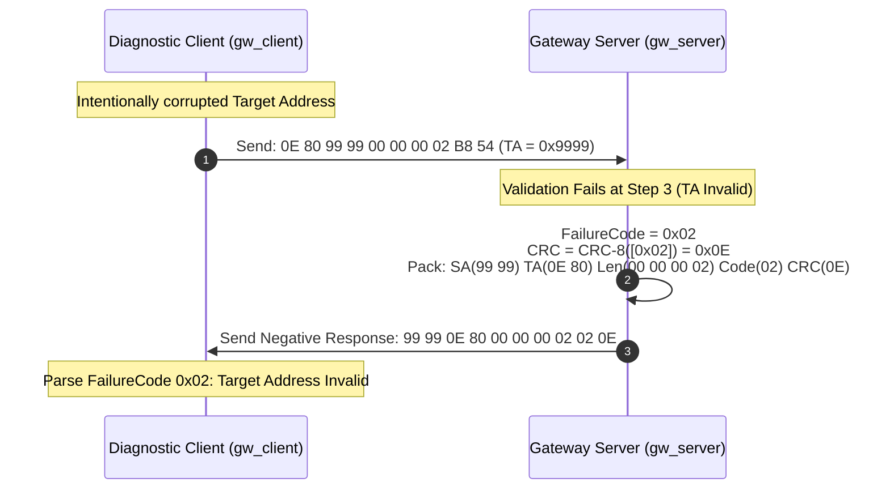

# Gateway (GW) Network Packet Communication — Architecture Document

## Phase-Wise Development Architecture (Server & Client)

---

## Table of Contents

1. [Architecture Overview](#1-architecture-overview)
2. [Phase 1 — Foundation & Core Infrastructure](#2-phase-1--foundation--core-infrastructure)
3. [Phase 2 — Protocol Engine & Frame Serialization](#3-phase-2--protocol-engine--frame-serialization)
4. [Phase 3 — Cryptographic & Transformation Pipeline](#4-phase-3--cryptographic--transformation-pipeline)
5. [Phase 4 — Networking Layer (TCP Server & TCP Client)](#5-phase-4--networking-layer-tcp-server--tcp-client)
6. [Phase 5 — Integration, Logging & Observability](#6-phase-5--integration-logging--observability)
7. [Phase 6 — Testing, Hardening & Deployment](#7-phase-6--testing-hardening--deployment)
8. [Project Directory Structure](#8-project-directory-structure)
9. [Module Dependency Graph](#9-module-dependency-graph)
10. [Data Flow Architecture](#10-data-flow-architecture)

---

## 1. Architecture Overview

### 1.1 Design Philosophy & Core Principles

The Gateway system is architected as a **modular, layered C application** adhering to the following core engineering principles:

| Principle | Rationale |
| :--- | :--- |
| **Separation of Concerns** | Each module owns a single, well-defined responsibility — networking, protocol parsing, crypto, nibble transformation — enabling isolated unit testing and modular reusability. |
| **Zero-Copy In-Place Processing** | Minimizes unnecessary `memcpy` operations by operating on buffer pointers in-place during header extraction, decryption, transformation, and validation stages. |
| **Fail-Fast Validation Hierarchy** | The verification pipeline short-circuits at the first detected failure (Length $\rightarrow$ SA $\rightarrow$ TA $\rightarrow$ CRC), immediately emitting a Negative Response without executing downstream cryptographic or transformation stages. |
| **Thread-Per-Connection Concurrency** | Each accepted TCP client connection is handled on a dedicated thread, ensuring the strict zero-drop policy under concurrent multi-client load. |
| **Defensive Memory & Bounds Safety** | Buffer reads are strictly bounded by `GW_MAX_PAYLOAD_SIZE`; unvalidated length fields cannot trigger unbounded dynamic allocations or buffer overruns. |
| **Common Core Reusability** | Cryptographic routines, CRC-8, protocol definitions, and TCP stream framing are unified in a shared static library (`libgw_common`), ensuring 100% behavioral parity between Server and Client binaries. |

### 1.2 Technology Stack

| Component | Choice | Rationale |
| :--- | :--- | :--- |
| **Programming Language** | C (C11 standard) | Deterministic memory layout, maximum performance, low-level bit manipulation, and direct socket API integration |
| **Build System** | CMake 3.20+ | Multi-target build management (`libgw_common`, `gw_server`, `gw_client`, unit tests) across Windows and Linux |
| **Threading Model** | POSIX Threads (pthreads) / Win32 Threads | Native platform threading for multi-client concurrent connection processing |
| **Networking API** | BSD Sockets / Winsock2 | Standard TCP/IP socket interface with cross-platform abstraction |
| **Testing Framework** | Unity (ThrowTheSwitch) | Lightweight, C-native testing framework suited for embedded and systems-level C testing |
| **Static Analysis & Sanitizers** | AddressSanitizer (ASan), clang-tidy | Memory safety, leak detection, and strict code quality enforcement |

### 1.3 Dual-Application System Model
The system comprises two distinct executable applications sharing a common protocol and cryptography core:

1. **Gateway Server (`gw_server`)**:
   - High-throughput TCP server listening on port `13400`.
   - Manages concurrent client sessions via dedicated worker threads.
   - Enforces a 4-stage fail-fast validation pipeline (Length $\rightarrow$ SA $\rightarrow$ TA $\rightarrow$ CRC).
   - Decrypts client payload (`XOR 0xAA`), executes nibble-swapping, encrypts response (`XOR 0x55`), computes response CRC-8, and routes back responses.
   - Zero-drop policy: every request receives an explicit Positive or Negative response.

2. **Diagnostic Client / Network Node Simulator (`gw_client`)**:
   - TCP client capable of connecting to `gw_server` on `127.0.0.1:13400` or arbitrary IP/port.
   - Assembles valid or intentionally malformed request packets (supporting automated conformance testing).
   - Encrypts payload with `0xAA` and computes CRC-8 over encrypted payload bytes.
   - Receives and parses responses: decrypts positive responses with `0x55`, extracts raw failure codes from negative responses.
   - Provides both an interactive CLI mode and an automated batch/test execution mode.

3. **Common Protocol & Processing Engine (`libgw_common`)**:
   - Reusable static library compiled once and linked into both `gw_server` and `gw_client`.
   - Encapsulates types, platform socket/thread abstraction, CRC-8, XOR crypto, nibble swapping, header parsing, and TCP stream framing.

### 1.4 System Layering Diagram

```mermaid
block-beta
    columns 2

    block:CLIENT_APP["Client Binary (gw_client)"]:1
        client_main["client_main.c<br>CLI & Test Runner"]
        tcp_client["tcp_client.c<br>Connect, Send & Recv"]
        req_builder["request_builder.c<br>Request Frame Assembly"]
        resp_parser["response_parser.c<br>Decode Pos/Neg Response"]
    end

    block:SERVER_APP["Server Binary (gw_server)"]:1
        server_main["server_main.c<br>Daemon & Lifecycle"]
        tcp_server["tcp_server.c<br>Bind, Listen & Accept"]
        conn_handler["conn_handler.c<br>Per-Connection Thread"]
        validator["validator.c<br>4-Stage Validation"]
        resp_builder["response_builder.c<br>Pos/Neg Frame Assembly"]
    end

    block:COMMON["Common Shared Core (libgw_common)"]:2
        columns 4
        framer["stream_framer.c<br>Two-Phase Framing"]
        parser["packet_parser.c<br>Header Extraction"]
        crypto_engine["crypto.c & transform.c<br>XOR & Nibble Swap"]
        crc_engine["crc8.c<br>CRC-8 Calculation"]
    end

    block:INFRA["Platform & Diagnostics"]:2
        columns 2
        platform["platform.c<br>Winsock / POSIX Abstraction"]
        logger["logger.c<br>Structured Logs & Hex Dump"]
    end

    CLIENT_APP --> COMMON
    SERVER_APP --> COMMON
    COMMON --> INFRA
```



---

## 2. Phase 1 — Foundation & Core Infrastructure

> **Goal**: Establish the CMake build system, cross-platform socket/thread abstraction, unified types, and logging engine.

### 2.1 Objectives
- [x] Configure multi-target CMake build (`libgw_common`, `gw_server`, `gw_client`, and unit tests).
- [x] Implement platform abstraction for Windows (Winsock2) and Linux (POSIX).
- [x] Define protocol structs, enums, addresses, and error codes in `gw_types.h`.
- [x] Build structured logger with timestamp, severity, and hex dumping capabilities.

### 2.2 Core Type Definitions (`include/common/gw_types.h`)
```c
#ifndef GW_TYPES_H
#define GW_TYPES_H

#include <stdint.h>
#include <stddef.h>
#include <stdbool.h>

/* Protocol Constants */
#define GW_DEFAULT_PORT         13400
#define GW_HEADER_SIZE          8
#define GW_CRC_SIZE             1
#define GW_MAX_PAYLOAD_SIZE     65535
#define GW_MAX_FRAME_SIZE       (GW_HEADER_SIZE + GW_MAX_PAYLOAD_SIZE + GW_CRC_SIZE)

/* Valid Node Addresses */
#define GW_ADDR_NODE_1_REQ_SA   0x0E80
#define GW_ADDR_NODE_2_REQ_SA   0xE008
#define GW_ADDR_GW_1_REQ_TA     0x3108
#define GW_ADDR_GW_2_REQ_TA     0x1380

/* XOR Cryptographic Keys */
#define GW_KEY_REQ_XOR          0xAA
#define GW_KEY_RESP_XOR         0x55

/* CRC-8 Parameters */
#define GW_CRC8_POLYNOMIAL      0x07
#define GW_CRC8_INITIAL_VAL     0x00

/* Protocol Failure Codes */
typedef enum {
    GW_FAIL_NONE              = 0x00,
    GW_FAIL_SRC_ADDR_INVALID  = 0x01,
    GW_FAIL_TGT_ADDR_INVALID  = 0x02,
    GW_FAIL_INTEGRITY         = 0x04,
    GW_FAIL_LENGTH_MISMATCH   = 0x08
} gw_failure_code_t;

/* Response Frame Type */
typedef enum {
    GW_RESP_POSITIVE = 0,
    GW_RESP_NEGATIVE = 1
} gw_response_type_t;

/* Parsed Packet Structure */
typedef struct {
    uint16_t source_addr;
    uint16_t target_addr;
    uint32_t length;        /* Payload + CRC length */
    uint32_t payload_len;   /* Length - 1 */
    const uint8_t *payload; /* Pointer to payload bytes inside frame */
    uint8_t  crc;           /* Received CRC byte */
} gw_packet_t;

#endif /* GW_TYPES_H */
```

### 2.3 Cross-Platform Abstraction (`include/common/platform.h`)
```c
#ifndef PLATFORM_H
#define PLATFORM_H

#include <stddef.h>

#ifdef _WIN32
    #include <winsock2.h>
    #include <ws2tcpip.h>
    #include <windows.h>
    typedef SOCKET gw_socket_t;
    typedef HANDLE gw_thread_t;
    #define GW_INVALID_SOCKET INVALID_SOCKET
    #define GW_SOCKET_ERROR   SOCKET_ERROR
#else
    #include <sys/socket.h>
    #include <netinet/in.h>
    #include <arpa/inet.h>
    #include <unistd.h>
    #include <pthread.h>
    typedef int gw_socket_t;
    typedef pthread_t gw_thread_t;
    #define GW_INVALID_SOCKET (-1)
    #define GW_SOCKET_ERROR   (-1)
#endif

int  gw_platform_init(void);
void gw_platform_cleanup(void);
int  gw_socket_close(gw_socket_t sock);
int  gw_thread_create(gw_thread_t *thread, void *(*func)(void *), void *arg);
void gw_thread_join(gw_thread_t thread);
void gw_sleep_ms(uint32_t milliseconds);

#endif /* PLATFORM_H */
```

---

## 3. Phase 2 — Protocol Engine & Frame Serialization

> **Goal**: Implement header parsing, the server validation pipeline, server response generation, and client request assembly.

### 3.1 Server Validation Pipeline (`src/server/validator.c`)
Evaluates received request frames according to the strict precedence hierarchy:



### 3.2 Client Request Builder (`include/client/request_builder.h`)
```c
/**
 * @brief Constructs a client request frame.
 *        Encrypts raw payload with XOR 0xAA, computes CRC-8, and packs header.
 *
 * @param source_addr   Source address (e.g., 0x0E80 or 0xE008)
 * @param target_addr   Target address (e.g., 0x3108 or 0x1380)
 * @param raw_payload   Unencrypted payload bytes
 * @param payload_len   Number of payload bytes
 * @param out_buf       Output buffer (caller-allocated, min 8 + payload_len + 1)
 * @param out_len       Output: total frame bytes written
 * @return 0 on success, -1 on error
 */
int gw_client_build_request(uint16_t source_addr, uint16_t target_addr,
                            const uint8_t *raw_payload, uint32_t payload_len,
                            uint8_t *out_buf, size_t *out_len);

/**
 * @brief Constructs an intentionally malformed request for negative response testing.
 */
int gw_client_build_invalid_request(uint16_t sa, uint16_t ta,
                                    const uint8_t *payload, uint32_t len,
                                    bool corrupt_crc, bool corrupt_len,
                                    uint8_t *out_buf, size_t *out_len);
```

### 3.3 Server Response Builder (`include/server/response_builder.h`)
```c
/**
 * @brief Constructs Positive Response frame.
 *        SA=Request.TA, TA=Request.SA, Encrypted Payload (XOR 0x55), CRC-8.
 */
int gw_build_positive_response(const gw_packet_t *req,
                               const uint8_t *transformed_payload,
                               uint32_t payload_len,
                               uint8_t *out_buf, size_t *out_len);

/**
 * @brief Constructs Negative Response frame (10 bytes).
 *        Length=2, FailureCode (unencrypted), CRC-8 over FailureCode.
 */
int gw_build_negative_response(const gw_packet_t *req,
                               gw_failure_code_t fail_code,
                               uint8_t *out_buf, size_t *out_len);
```

---

## 4. Phase 3 — Cryptographic & Transformation Pipeline

> **Goal**: Implement CRC-8 computation, XOR encryption/decryption, and high/low nibble swapping.

### 4.1 C Implementation Specifications

#### CRC-8 Engine (`src/common/crc8.c`)
```c
#include "common/crc8.h"

uint8_t gw_crc8(const uint8_t *data, size_t length, uint8_t poly, uint8_t init) {
    uint8_t crc = init;
    for (size_t i = 0; i < length; i++) {
        crc ^= data[i];
        for (uint8_t bit = 0; bit < 8; bit++) {
            if (crc & 0x80) {
                crc = (uint8_t)((crc << 1) ^ poly);
            } else {
                crc = (uint8_t)(crc << 1);
            }
        }
    }
    return crc;
}
```

#### XOR Crypto & Nibble Swap Engine (`src/common/crypto.c`, `src/common/transform.c`)
```c
/* In-place XOR transformation */
void gw_xor_buffer(uint8_t *data, size_t length, uint8_t key) {
    for (size_t i = 0; i < length; i++) {
        data[i] ^= key;
    }
}

/* In-place high and low nibble swap */
void gw_swap_nibbles(uint8_t *data, size_t length) {
    for (size_t i = 0; i < length; i++) {
        data[i] = (uint8_t)(((data[i] & 0x0F) << 4) | ((data[i] & 0xF0) >> 4));
    }
}
```

### 4.2 End-to-End Test Vector Trace
| Step | Operation | Value | Binary |
| :--- | :--- | :---: | :---: |
| Client Input | Raw payload | `0x12` | `0001 0010` |
| Client Transmit | Encrypt: `0x12 ^ 0xAA` | `0xB8` | `1011 1000` |
| Server Receive | Decrypt: `0xB8 ^ 0xAA` | `0x12` | `0001 0010` |
| Server Transform | Nibble Swap | `0x21` | `0010 0001` |
| Server Transmit | Encrypt: `0x21 ^ 0x55` | `0x74` | `0111 0100` |
| Client Receive | Decrypt: `0x74 ^ 0x55` | `0x21` | `0010 0001` |

---

## 5. Phase 4 — Networking Layer (TCP Server & TCP Client)

> **Goal**: Implement the TCP networking modules for both the Gateway Server (`gw_server`) and the Test/Diagnostic Client (`gw_client`), along with shared stream framing.

### 5.1 Shared Two-Phase TCP Stream Framing (`src/common/stream_framer.c`)
TCP provides an unstructured byte stream. Both server and client must frame messages identically:

```
Step 1: Read exactly 8 bytes (Header) -> Extract Length (uint32)
Step 2: Read exactly Length bytes     -> [Encrypted Payload (N) + CRC (1)]
Total Packet Size = 8 + Length bytes
```

```c
ssize_t gw_recv_exact(gw_socket_t sock, uint8_t *buffer, size_t count);
int     gw_read_frame(gw_socket_t sock, uint8_t *buffer, size_t max_len, size_t *total_read);
```

### 5.2 Server Networking (`src/server/tcp_server.c` & `src/server/conn_handler.c`)

- **Socket Lifecycle**:
  - Creates non-blocking / selectable socket, sets `SO_REUSEADDR`, binds to `0.0.0.0:13400`, calls `listen(backlog=32)`.
  - Main accept loop waits for incoming connections and spawns a worker thread per client.
- **Worker Thread Lifecycle**:
  - Continuously invokes `gw_read_frame()` on the client socket.
  - Parses header $\rightarrow$ runs 4-stage validator.
  - If validation succeeds: decrypts (`0xAA`) $\rightarrow$ swaps nibbles $\rightarrow$ encrypts (`0x55`) $\rightarrow$ computes CRC-8 $\rightarrow$ transmits Positive Response.
  - If validation fails: builds 10-byte Negative Response with unencrypted failure code $\rightarrow$ transmits.
  - Loops until client disconnects; closes socket safely.

### 5.3 Client Networking (`include/client/tcp_client.h` & `src/client/tcp_client.c`)

```c
#ifndef TCP_CLIENT_H
#define TCP_CLIENT_H

#include "common/gw_types.h"
#include "common/platform.h"

typedef struct {
    gw_socket_t sock;
    char server_ip[64];
    uint16_t server_port;
    bool is_connected;
} gw_client_t;

/* Response parsed by client */
typedef struct {
    gw_response_type_t type;
    uint16_t source_addr;
    uint16_t target_addr;
    uint8_t  failure_code;       /* Valid only if type == GW_RESP_NEGATIVE */
    uint8_t  *decrypted_payload; /* Decrypted with 0x55; valid if GW_RESP_POSITIVE */
    uint32_t payload_len;
} gw_client_response_t;

int  gw_client_init(gw_client_t *client, const char *server_ip, uint16_t port);
int  gw_client_connect(gw_client_t *client);
void gw_client_disconnect(gw_client_t *client);

/**
 * @brief Sends a request packet, awaits the response, validates CRC, and decodes payload.
 */
int  gw_client_send_request(gw_client_t *client,
                             const uint8_t *frame_data, size_t frame_len,
                             gw_client_response_t *resp);

#endif /* TCP_CLIENT_H */
```

### 5.4 Client CLI & Test Modes (`src/client/client_main.c`)
The client binary supports two modes:
1. **Interactive Mode**: Allows typing hex payload bytes and observing server positive/negative responses in real time.
2. **Automated Test Runner**: Executes all predefined test scenarios (Valid single-byte, valid multi-byte, invalid SA, invalid TA, CRC error, length mismatch) and verifies exit codes.

---

## 6. Phase 5 — Integration, Logging & Observability

> **Goal**: Wire Server and Client applications, structured logging, real-time hex dumping, and server metrics collection.

### 6.1 Structured Logging Architecture
Both server and client use the unified logger to emit formatted messages:
```
[2026-10-16 19:15:02.102] [INFO ] [SERVER] Client connected from 127.0.0.1:58422
[2026-10-16 19:15:02.103] [DEBUG] [FRAMER] RX: 0E 80 31 08 00 00 00 02 B8 54 (10 bytes)
[2026-10-16 19:15:02.103] [INFO ] [VALID ] Request validated successfully (SA=0x0E80, TA=0x3108)
[2026-10-16 19:15:02.103] [DEBUG] [TRANS ] Decrypt: [12] -> Swap: [21] -> Encrypt: [74] -> CRC: [42]
[2026-10-16 19:15:02.104] [DEBUG] [FRAMER] TX: 31 08 0E 80 00 00 00 02 74 42 (10 bytes)
[2026-10-16 19:15:02.104] [INFO ] [SERVER] Positive response delivered
```

### 6.2 Server Metrics Engine (`src/server/server_metrics.c`)
Tracks operational telemetry atomically:
- Total requests received
- Positive responses generated
- Breakdown of negative responses (`0x01`, `0x02`, `0x04`, `0x08`)
- Active and cumulative client connection count

---

## 7. Phase 6 — Testing, Hardening & Deployment

> **Goal**: Comprehensive verification across unit tests, system integration tests, concurrent multi-client load tests, and memory sanitization.

### 7.1 Test Matrix

| Test Suite | Target | Executable / Method | Purpose |
| :--- | :--- | :--- | :--- |
| **Unit Tests** | `libgw_common` | `test_common` (Unity) | Verifies CRC-8, XOR, nibble swap, parser |
| **Protocol Tests** | `validator` | `test_validator` (Unity) | Validates strict precedence for 0x08, 0x01, 0x02, 0x04 |
| **End-to-End System** | `gw_server` + `gw_client` | `test_integration` | Full socket roundtrip for all problem statement test cases |
| **Stress & Concurrency** | `gw_server` | `test_concurrent` | Spawns 32 parallel clients sending 1,000 requests each |
| **Memory Safety** | Both binaries | Valgrind / AddressSanitizer | Ensures zero leaks, zero buffer overflows |

---

## 8. Project Directory Structure

```
GW Network packet communication/
├── docs/
│   ├── GW_Requirement_Specification.docx   # Original Word requirement document
│   ├── problemStatement.md                  # Enhanced problem statement & protocol spec
│   ├── architecture.md                      # This phase-wise architecture document
│   └── prompt.md                            # Task prompt history
│
├── include/                                 # Public Header Files
│   ├── common/                              # Shared types, crypto, framing & platform
│   │   ├── gw_types.h                       # Structs, failure codes, address macros
│   │   ├── gw_config.h                      # Port, buffer limits, timeouts
│   │   ├── platform.h                       # Windows / POSIX socket & thread wrapper
│   │   ├── logger.h                         # Logging and hex dump API
│   │   ├── crc8.h                           # CRC-8 calculation functions
│   │   ├── crypto.h                         # XOR encryption/decryption routines
│   │   ├── transform.h                      # High/low nibble swap engine
│   │   ├── packet_parser.h                  # Big-endian header extraction
│   │   └── stream_framer.h                  # Two-phase TCP stream framing
│   │
│   ├── server/                              # Gateway Server Headers
│   │   ├── tcp_server.h                     # Server socket lifecycle & accept loop
│   │   ├── conn_handler.h                   # Worker thread & session handler
│   │   ├── validator.h                      # 4-stage validation pipeline
│   │   ├── response_builder.h               # Positive & Negative response generator
│   │   └── server_metrics.h                 # Telemetry counters
│   │
│   └── client/                              # Client & Test Simulator Headers
│       ├── tcp_client.h                     # Client socket connection, send & recv
│       ├── request_builder.h                # Request frame assembly (valid & malformed)
│       └── response_parser.h                # Decodes positive/negative server responses
│
├── src/                                     # Source Implementations
│   ├── common/                              # Shared Core Library (libgw_common)
│   │   ├── platform.c                       # OS socket/thread implementations
│   │   ├── logger.c                         # Structured logger & hex dumper
│   │   ├── crc8.c                           # CRC-8 algorithm implementation
│   │   ├── crypto.c                         # XOR encrypt/decrypt functions
│   │   ├── transform.c                      # Nibble swap logic
│   │   ├── packet_parser.c                  # Header parser
│   │   └── stream_framer.c                  # TCP exact-read framing logic
│   │
│   ├── server/                              # Gateway Server Binary (gw_server)
│   │   ├── server_main.c                    # Entry point, CLI args, signal handling
│   │   ├── tcp_server.c                     # Bind, listen, accept dispatcher
│   │   ├── conn_handler.c                   # Worker thread processing pipeline
│   │   ├── validator.c                      # 4-stage validation checks
│   │   ├── response_builder.c               # Response frame construction
│   │   └── server_metrics.c                 # Atomic telemetry tracking
│   │
│   └── client/                              # Client Simulator Binary (gw_client)
│       ├── client_main.c                    # CLI test runner & interactive prompt
│       ├── tcp_client.c                     # Socket connect & synchronous dispatch
│       ├── request_builder.c                # Request packet serialization
│       └── response_parser.c                # Response unpacking & decoding
│
├── tests/                                   # Unit & Integration Test Suites
│   ├── test_runner.c                        # Test main entry
│   ├── test_crc8.c                          # CRC-8 unit tests
│   ├── test_crypto.c                        # XOR & nibble swap tests
│   ├── test_parser.c                        # Header parsing tests
│   ├── test_validator.c                     # Server validation pipeline tests
│   ├── test_integration.c                   # Full client-server TCP roundtrip tests
│   └── test_concurrent.c                    # Multi-threaded stress tests
│
├── CMakeLists.txt                           # Root build configuration
└── README.md                                # Build instructions & execution guide
```

---

## 9. Module Dependency Graph



---

## 10. Data Flow Architecture

### 10.1 Complete End-to-End Client $\longleftrightarrow$ Server Interaction



### 10.2 Negative Response Interaction (Validation Failure Example)


