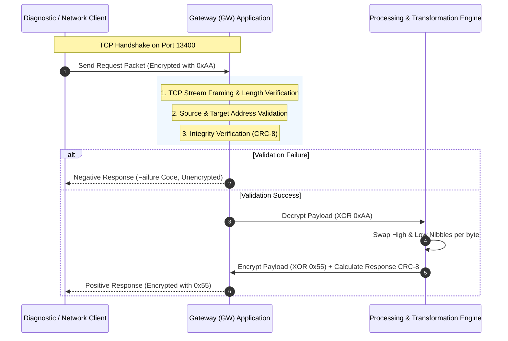
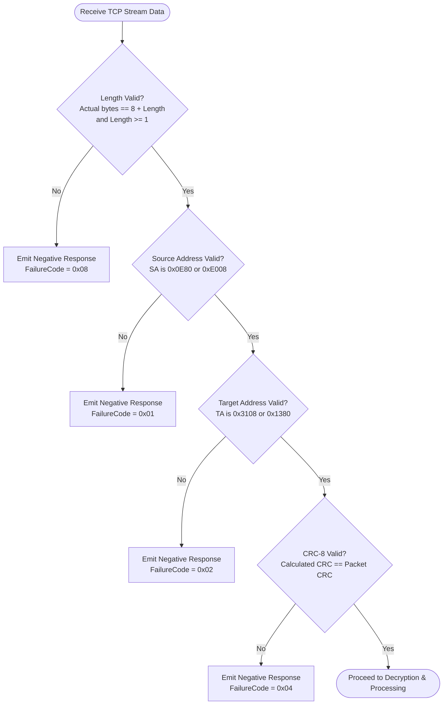

# Gateway (GW) Network Packet Communication System
## Engineering Problem Statement & Protocol Specification

---

### Document Overview
This document specifies the technical requirements and architecture for the **Gateway (GW) Application**, a specialized TCP/IP network protocol converter and payload transformer operating in a Client/Server environment. The Gateway acts as an intermediary node responsible for validating, authenticating, decrypting, transforming, and re-encrypting network packets exchanged between diagnostic clients and internal network nodes.

---

## 1. System Architecture & Context

### 1.1 Architectural Overview
The system follows a high-performance Client/Server model over standard TCP/IP. The Gateway application operates as a TCP server listening for incoming client requests, performing packet validation, payload transformation, integrity checks, and routing response packets back to the client.



### 1.2 Communication Endpoints & Network Topology
- **Transport Layer**: TCP/IP (reliable, stream-oriented).
- **Listening Port**: `13400` (Standard ISO 13400 DoIP default port).
- **Listening Interface**: Loopback (`127.0.0.1`) or wildcard interface (`0.0.0.0` to allow multi-interface binding).
- **Network Byte Order**: Big-Endian (Most Significant Byte first) is standard for all multi-byte header fields (`Source Address`, `Target Address`, `Length`).

---

## 2. Protocol Frame Format Specifications

Every packet exchanged between the Client and Gateway consists of a fixed **8-byte header**, followed by a **variable-length payload field**, and terminated with a **1-byte CRC**.

### 2.1 Request Frame Format (Client $\rightarrow$ Gateway)

| Field Name | Offset | Length | Type | Description / Valid Values |
| :--- | :---: | :---: | :---: | :--- |
| **Source Address (SA)** | Byte 0–1 | 2 Bytes | `uint16` | Allowed: `0x0E80` or `0xE008` |
| **Target Address (TA)** | Byte 2–3 | 2 Bytes | `uint16` | Allowed: `0x3108` or `0x1380` |
| **Length** | Byte 4–7 | 4 Bytes | `uint32` | Size of Payload ($N$) + CRC (1 byte) = $N + 1$ |
| **Encrypted Payload** | Byte 8–($8+N-1$) | $N$ Bytes | `bytes` | Raw payload bytes encrypted using `XOR 0xAA` |
| **CRC** | Byte $(8+N)$ | 1 Byte | `uint8` | CRC-8 calculated over the encrypted payload data |

#### Byte Layout:
```
 0                   1                   2                   3
 0 1 2 3 4 5 6 7 8 9 0 1 2 3 4 5 6 7 8 9 0 1 2 3 4 5 6 7 8 9 0 1
+-+-+-+-+-+-+-+-+-+-+-+-+-+-+-+-+-+-+-+-+-+-+-+-+-+-+-+-+-+-+-+-+
|     Source Address (2B)       |     Target Address (2B)       |
+-+-+-+-+-+-+-+-+-+-+-+-+-+-+-+-+-+-+-+-+-+-+-+-+-+-+-+-+-+-+-+-+
|                         Length (4B)                           |
+-+-+-+-+-+-+-+-+-+-+-+-+-+-+-+-+-+-+-+-+-+-+-+-+-+-+-+-+-+-+-+-+
| Encrypted Data 1| Encrypted Data 2| ...         | Encrypted Data N|
+-+-+-+-+-+-+-+-+-+-+-+-+-+-+-+-+-+-+-+-+-+-+-+-+-+-+-+-+-+-+-+-+
|    CRC (1B)   |
+-+-+-+-+-+-+-+-+
```

---

### 2.2 Positive Response Frame Format (Gateway $\rightarrow$ Client)

Returned when all validation checks pass. Addresses are inverted (the Gateway responds from the target to the source).

| Field Name | Offset | Length | Type | Description / Value |
| :--- | :---: | :---: | :---: | :--- |
| **Source Address (SA)** | Byte 0–1 | 2 Bytes | `uint16` | Copied from Request's Target Address (`0x3108` or `0x1380`) |
| **Target Address (TA)** | Byte 2–3 | 2 Bytes | `uint16` | Copied from Request's Source Address (`0x0E80` or `0xE008`) |
| **Length** | Byte 4–7 | 4 Bytes | `uint32` | Size of Transformed Payload ($N$) + CRC (1 byte) = $N + 1$ |
| **Encrypted Payload** | Byte 8–($8+N-1$) | $N$ Bytes | `bytes` | Transformed payload encrypted using `XOR 0x55` |
| **CRC** | Byte $(8+N)$ | 1 Byte | `uint8` | CRC-8 calculated over the encrypted response payload |

---

### 2.3 Negative Response Frame Format (Gateway $\rightarrow$ Client)

Returned immediately when any validation failure is detected during packet inspection.

| Field Name | Offset | Length | Type | Description / Value |
| :--- | :---: | :---: | :---: | :--- |
| **Source Address (SA)** | Byte 0–1 | 2 Bytes | `uint16` | Target Address from request (or default `0x3108` / `0x1380`) |
| **Target Address (TA)** | Byte 2–3 | 2 Bytes | `uint16` | Source Address from request (or default `0x0E80` / `0xE008`) |
| **Length** | Byte 4–7 | 4 Bytes | `uint32` | Fixed: `0x00000002` (1 byte Failure Code + 1 byte CRC) |
| **Failure Code** | Byte 8 | 1 Byte | `uint8` | Unencrypted failure status code (see table below) |
| **CRC** | Byte 9 | 1 Byte | `uint8` | CRC-8 calculated over the 1-byte Failure Code |

> [!IMPORTANT]
> The **Failure Code** must **NOT** be encrypted. It is transmitted as plain unencrypted binary data.

---

## 3. Failure Codes & Validation Hierarchy

### 3.1 Failure Code Catalog

| Code | Hex | Failure Type | Description |
| :---: | :---: | :--- | :--- |
| `1` | `0x01` | **Source Address Invalid** | The received Source Address does not match `0x0E80` or `0xE008`. |
| `2` | `0x02` | **Target Address Invalid** | The received Target Address does not match `0x3108` or `0x1380`. |
| `4` | `0x04` | **Integrity Failure** | The calculated CRC-8 over the received payload does not match the CRC byte. |
| `8` | `0x08` | **Payload Length Mismatch** | The actual received TCP packet length does not match $8 + \text{Length}$, or $\text{Length} < 1$. |

### 3.2 Verification Pipeline & Precedence Rules
To ensure consistent negative responses across edge conditions, the Gateway must evaluate received frames in a strictly prioritized sequence:



---

## 4. Cryptographic & Transformation Engine

### 4.1 Request Payload Decryption
Each incoming payload byte is obfuscated using an XOR mask of `0xAA`:
$$\text{DecryptedData}[i] = \text{EncryptedData}[i] \oplus \text{0xAA}$$

### 4.2 Business Logic: Nibble Swap Operation
For each decrypted byte, swap the high nibble (bits 7:4) and low nibble (bits 3:0):
$$\text{SwappedData}[i] = ((\text{DecryptedData}[i] \ \& \ \text{0x0F}) \ll 4) \ \mid \ ((\text{DecryptedData}[i] \ \& \ \text{0xF0}) \gg 4)$$

#### Example:
- Decrypted Byte: `0x3A` (`0011 1010` in binary)
- High Nibble: `0x3` (`0011`)
- Low Nibble: `0xA` (`1010`)
- Swapped Byte: `0xA3` (`1010 0011` in binary)

### 4.3 Response Payload Encryption
Before transmission in a Positive Response, the swapped payload bytes must be re-encrypted using an XOR mask of `0x55`:
$$\text{ResponseEncryptedData}[i] = \text{SwappedData}[i] \oplus \text{0x55}$$

### 4.4 End-to-End Transformation Walkthrough
| Stage | Operation | Byte Value (Hex) | Binary Representation |
| :--- | :--- | :---: | :---: |
| **Input** | Original Client Payload Byte | `0x12` | `0001 0010` |
| **Request Transmission** | Encrypt: `0x12 ^ 0xAA` | `0xB8` | `1011 1000` |
| **GW Receiving** | Decrypt: `0xB8 ^ 0xAA` | `0x12` | `0001 0010` |
| **GW Processing** | Nibble Swap: `0x12` $\rightarrow$ `0x21` | `0x21` | `0010 0001` |
| **GW Responding** | Encrypt: `0x21 ^ 0x55` | `0x74` | `0111 0100` |
| **Client Receiving** | Decrypt: `0x74 ^ 0x55` | `0x21` | `0010 0001` |

---

## 5. Integrity Verification (CRC-8 Specification)

The integrity of all payload segments (and failure code payloads in negative responses) is validated using the **CRC-8** algorithm.

### 5.1 CRC-8 Standard Configuration Parameters
- **Polynomial**: `0x07` ($x^8 + x^2 + x + 1$, standard CRC-8 / SMBus) or `0x1D` (SAE J1850 / AUTOSAR profile).
- **Initial Value (`Init`)**: `0x00`
- **Reflect Input (`RefIn`)**: `False`
- **Reflect Output (`RefOut`)**: `False`
- **Final XOR (`XorOut`)**: `0x00`

### 5.2 CRC Calculation Scope
- **In Request**: Calculated over the *Encrypted Payload Data* array: $[\text{Byte}_8, \dots, \text{Byte}_{8+N-1}]$.
- **In Positive Response**: Calculated over the *Encrypted Response Payload Data* array.
- **In Negative Response**: Calculated over the single unencrypted byte $[\text{FailureCode}]$.

```c
#include <stdint.h>
#include <stddef.h>

/**
 * @brief Computes CRC-8 checksum over a byte buffer.
 * 
 * @param data Pointer to input data buffer
 * @param length Number of bytes in buffer
 * @param poly CRC-8 polynomial (Default: 0x07)
 * @param init Initial CRC value (Default: 0x00)
 * @return uint8_t Calculated CRC-8 checksum
 */
uint8_t calculate_crc8(const uint8_t *data, size_t length, uint8_t poly, uint8_t init) {
    uint8_t crc = init;
    for (size_t i = 0; i < length; i++) {
        crc ^= data[i];
        for (uint8_t bit = 0; bit < 8; bit++) {
            if (crc & 0x80) {
                crc = (uint8_t)((crc << 1) ^ poly);
            } else {
                crc = (uint8_t)(crc << 1);
            }
        }
    }
    return crc;
}
```

---

## 6. Network & Concurrency Requirements

### 6.1 TCP Stream Management & Framing
1. **Stream-based Message Delimitation**: TCP transmits a continuous byte stream without inherent message boundaries. The Gateway must read the 8-byte header first, parse the `Length` field, and continue reading until the full packet ($8 + \text{Length}$ bytes) is accumulated before parsing.
2. **Packet Concatenation & Fragmentation**: The Gateway must handle cases where multiple requests arrive in a single TCP segment or where a single packet is fragmented across multiple network frames.

### 6.2 High-Throughput & Concurrency Model
- **Non-blocking / Multi-threaded Execution**: The server must support simultaneous connections and concurrent incoming requests from multiple clients or network nodes.
- **Zero-Drop Policy**: Under no circumstance should an incoming request be dropped, ignored, or skipped. Every received request must receive an explicit Positive or Negative response.
- **Connection Lifecycle**: Supports both persistent long-lived TCP connections with pipelined requests and transient short-lived connections.

---

## 7. Comprehensive Test Vectors & Scenarios

### Scenario 1: Valid Single-Byte Request (Positive Response)
- **Request Parameters**:
  - Source Address: `0x0E80`
  - Target Address: `0x3108`
  - Raw Payload: `[0x12]`
  - Encrypted Payload: `0x12 ^ 0xAA = 0xB8`
  - CRC: `CRC8([0xB8])` $\rightarrow$ `0x21` (using poly `0x07`, init `0x00`)
  - Length: $1 + 1 = 2$ (`0x00000002`)
- **Raw Request Bytes**:
  `0E 80 31 08 00 00 00 02 B8 21`
- **Gateway Processing**:
  - Validates SA (`0x0E80`), TA (`0x3108`), Length (`2`), CRC (`0x21`).
  - Decrypts: `0xB8 ^ 0xAA = 0x12`.
  - Swaps nibbles: `0x12` $\rightarrow$ `0x21`.
  - Encrypts for response: `0x21 ^ 0x55 = 0x74`.
  - Calculates response CRC: `CRC8([0x74])` $\rightarrow$ `0x4B`.
- **Expected Positive Response**:
  `31 08 0E 80 00 00 00 02 74 4B`

---

### Scenario 2: Invalid Source Address (Negative Response 0x01)
- **Raw Request Bytes**:
  `AA BB 31 08 00 00 00 02 B8 54` (`SA = 0xAABB`, invalid)
- **Gateway Evaluation**:
  - Length is 2 bytes (passes length check).
  - Source Address is `0xAABB` $\notin$ `{0x0E80, 0xE008}` $\rightarrow$ Failure `0x01`.
- **Expected Negative Response**:
  - Source Address: `31 08`
  - Target Address: `AA BB` (echoed)
  - Length: `00 00 00 02`
  - Failure Code: `01`
  - CRC: `CRC8([0x01])` $\rightarrow$ `0x07`
- **Output Bytes**:
  `31 08 AA BB 00 00 00 02 01 07`

---

### Scenario 3: Invalid Target Address (Negative Response 0x02)
- **Raw Request Bytes**:
  `0E 80 99 99 00 00 00 02 B8 54` (`TA = 0x9999`, invalid)
- **Gateway Evaluation**:
  - Length check passes.
  - SA (`0x0E80`) valid.
  - TA (`0x9999`) $\notin$ `{0x3108, 0x1380}` $\rightarrow$ Failure `0x02`.
- **Expected Negative Response**:
  `99 99 0E 80 00 00 00 02 02 0E`

---

### Scenario 4: Integrity Failure / CRC Mismatch (Negative Response 0x04)
- **Raw Request Bytes**:
  `0E 80 31 08 00 00 00 02 B8 FF` (Corrupted CRC `0xFF` instead of `0x54`)
- **Gateway Evaluation**:
  - Length, SA, and TA valid.
  - Calculated CRC (`0x54`) $\neq$ received CRC (`0xFF`) $\rightarrow$ Failure `0x04`.
- **Expected Negative Response**:
  `31 08 0E 80 00 00 00 02 04 1C`

---

### Scenario 5: Payload Length Mismatch (Negative Response 0x08)
- **Raw Request Bytes**:
  `0E 80 31 08 00 00 00 05 B8 54` (Header specifies Length = 5, but only 2 payload bytes provided)
- **Gateway Evaluation**:
  - Data buffer exhausted before reaching $8 + \text{Length}$ bytes $\rightarrow$ Failure `0x08`.
- **Expected Negative Response**:
  `31 08 0E 80 00 00 00 02 08 38`

---

## 8. Non-Functional & Operational Requirements

1. **Performance & Latency**: Processing overhead per packet must be sub-millisecond ($< 1\,\text{ms}$) excluding network transit time.
2. **Memory Safety & Robustness**: Malformed packets, fuzz data, buffer overruns, or extreme lengths (e.g. `Length = 0xFFFFFFFF`) must be trapped cleanly without server crashes or memory exhaustion.
3. **Observability & Logging**:
   - Structured logging of all connections (Client IP, port, timestamp).
   - Trace log containing raw hex dump of received and transmitted frames.
   - Metrics counter for request count, positive responses, and breakdown by failure code (`0x01`, `0x02`, `0x04`, `0x08`).
